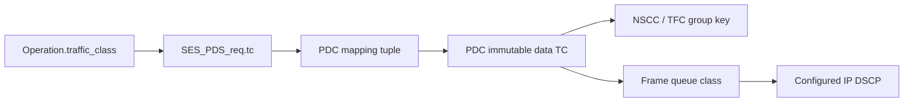

# CMS 数据流量类与包裁剪

§3.6.6 要求不同数据 TC 使用不同 CCC。原生 `Operation::traffic_class`（默认0）
现贯穿 SES 请求、PDC 映射、不可变 PDC 身份、NSCC/TFC 分组和 NIC/IP DSCP：

提交在预约 Sync Group、消息 ID、MR 和 PDC 之前检查类号。可靠 RUD/ROD 的非零类
须经 `PdsHost::configure_data_traffic_class` 或该类的 `configure_trimming` 配置。
本地有8个队列类，DSCP 为0～63；不与其他数据类或保留的包角色冲突。
默认控制 DSCP48，注册裁剪策略时可统一配置其他控制 DSCP。这些数值是显式
仿真配置，不是规范固定的 DSCP 数值。非零 RUDI/UUD 暂时显式拒绝。

`CMS::Connection::traffic_class` 加入连接身份和源端分组查询。同一 peer+TC 的
RUD 可共享 CCC，ROD 各自独立。TFC 的8位 CCC_ID 在一个 peer 的所有活动源 CCC
中唯一，不按 TC 重复使用；目的按 source peer+CCC_ID 关联预算。ACK/Credit 等
反向控制使用控制类1。编号 ROD NOOP/Close 保留自己的数据类，避免越过先前数据。

接收 upcall 的 `local_data_traffic_class` 是接收 PDC 本地的发送类，用于精确 CMS
buffer lease 身份，不从对端 DSCP 推导。例如本机 TC3 发起 READ，对端可由 TC0
返回数据，而本机释放缓冲时仍需匹配 TC3 的 PDC/CCC。

## 有限发送副本预算

原 FIFO producer 在首条消息超过8个副本槽时可能让后续 TC 尚未进入 PDS/NIC。
独立负向探针用1024字节 TC0（16个64字节包）和512字节 TC3 重现：丢失首包后，
`requests0=8`、`requests3=0`、`queued=8`，两条操作均未完成。
日志 `/tmp/softue-native-tc-long-flow-probe-tests.log` 保留这一失败。

新的仿真策略按活动 TC 分享有限副本预算，优先生产占用较少的类，平局轮换；
不撤销已有副本。只选择每类第一条待生产消息，保持类内提交顺序。单 TC 保留原
FIFO 路径；deferrable、rendezvous 或 READ 结果窗口受阻只阻止该类的首条消息。
这是 §3.6.8 允许的显式调度策略，不是规范指定算法。容量过小或预算已被占用时
仍可能有正常本地资源背压，不承诺无限资源或零等待。

`native_traffic_class_test` 覆盖16个1024/512字节双流场景、4个反向 READ 场景、
4个错误清理/同 Endpoint 复用场景及配置边界。大 WRITE 的错误 key 不阻止另一类
成功；MSG_ERROR 尾清理后，两个类再次合法 WRITE，逐类副本数及 producer 数归零。
只读诊断接口对非法类索引抛出 `out_of_range`，不将其用于数组访问。

## 每个数据类的裁剪策略

`TrimmingOptions::data_traffic_class` 标识 DATA 和 NO_TRIM 的本地队列。Host 按类
注册策略；`LinkConfig::additional_trimming` 补充原有单策略入口，保留默认 TC0。
整个候选配置校验成功后才更新映射，失败不改变现有规则。各类 DATA、NO_TRIM、
TRIMMED、LASTHOP DSCP 含义必须无歧义，各类共用一个控制 DSCP。

交换机每跳从实际 IP DSCP 重建队列；Host 从裁剪 DSCP 选择解码策略。TFC 类型
13/14 的裁剪请求保留16字节 PDS 头，包括 CCC_ID/credit_target，不解码 SES，
不将残留字节视为有效语义数据或新接收信用。

`multi_traffic_class_trimming_test` 包含16组 RUD/ROD、NSCC/TFC 开关及
IPv4/UDP、IPv6/native 场景。两条数据流经过真实有限队列，TC3 溢出并产生
LASTHOP 裁剪通知，原 PDS NACK/重传恢复后检查两个目标区域的完整字节和唯一完成。
适配器主动清除 Frame 队列类，验证实际 DSCP 分类；另有16组信用扩展头保留/
截短边界及配置冲突回归。

## 证据边界

- `593e72199b2050585d0f246c76d5ea8813f94ab5`：独立 CMS 模型探针，普通0.03秒、
  Sanitizer 0.04秒；仅分组查询，不是端到端多 TC。
- `b1c24bc28e82edb9f91f4630ba49131324f9818f`：原生公平 producer 的13项范围，
  普通1.22秒、ASan/UBSan/leak 12.34秒；不包含之后的错误复用及裁剪增量。
- `54a1e64a56adfb6b883f8577875f5fe67850b446`：上述多 TC、错误复用和裁剪的16项
  范围全部通过，普通1.81秒、ASan/UBSan/leak 15.89秒。日志为
  `/tmp/softue-multi-tc-trim-{normal,asan}-tests.log`，报告为
  `/tmp/softue-multi-tc-trim-scoped-report.json`。均为虚拟时间场景；与独立 RCCC
  编译可重叠，墙钟时间不作为性能结果。
- `afaca88f68928f7ec105d9d022fe136c0f043fa9` 的完整176项证据包含真实 TFC，
  不包含这里的多 TC 增量。当前整合版准备179项完整回归，尚无该范围通过声明。

非零 RUDI/UUD、完整队列/管理配置及 Profile 审核仍开放，四种 Profile 均未宣布完成。

完整固定67ae310普通回归为178/179，135.06秒；`pds_simulation_test` 在 legacy
原始提交TC1时失败。新DSCP配置检查误套到 LegacySup1 入口，修正仅将标准IP
配置限制用于Uet11，legacy继续保留0～7的本地PDC类身份，类8仍在分配前拒绝。
legacy回归增加TC0/1/7各两次确定性轨迹比较。原失败报告
`/tmp/softue-multi-tc-67-full-failure-report.json` 保留；67的Sanitizer完整构建成功，
因发现普通生产回归未启动全量Sanitizer测试。修正版本需要重新完整验证。
