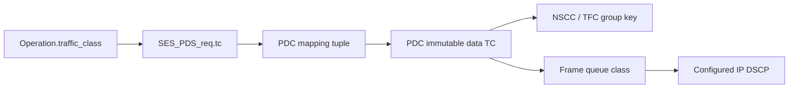

# CMS 的数据流量类身份

§3.6.6 要求不同数据 TC 使用不同 CCC：一个 TC 的拥塞或信用不足不能阻止另一个
TC 的合法发送。源 RUD 的共享查询因此至少需要 peer+outgoing data TC；ROD 仍按
各自 PDC 实例独立分配。ACK/control 使用的反向流量类不作为该源数据 CCC 的 TC。

`CMS::Connection::traffic_class` 是本地源数据 TC，默认0，加入连接身份以及 NSCC/TFC
的源上下文 group key。TFC 的8位 CCC_ID 仍在一个 peer 的所有活动源 CCC 中唯一，
不会为不同 TC 各自复用相同标识符；目的继续按 source peer+CCC_ID 关联共享预算。

`cms_traffic_class_test` 直接在 CMS 接口上验证：

- 同 TC 的两个 RUD PDC 共享窗口/信用，不同 TC 独立。
- TC 0 用满 NSCC 窗口后，TC 1 仍能发送。
- TC 1 的累计 TFC 授权不能补充 TC 0；同 TC 另一成员收到的授权可共同使用。
- 关闭一个成员不会清除仍活动的其他 TC 或共享成员状态。

固定源 `593e72199b2050585d0f246c76d5ea8813f94ab5` 的独立 CMS CMake/CTest 探针
已通过：普通0.03秒，ASan/UBSan/leak 0.04秒。探针直接编译本版本的 TfcEngine.cpp
与 CmsTrafficClassTest.cpp，并链接固定6f4115d版本未改动的 softue_message（普通/
Sanitizer 分别匹配）。日志为 `/tmp/softue-cms-tc-probe-{normal,asan}-tests.log`，
探针 CMake 定义为 `/tmp/softue-cms-tc-probe/CMakeLists.txt`。这不是仓库完整177项构建。

它只处理 CMS 分组身份，**尚未**把 Native Operation、
PDC 创建、NIC 排队和 DSCP/TC 配置贯穿连接。`PdsHost::enable_tfc` 仍显式限制 TC 0，
原有 Host 构造的 Connection 也默认 TC 0。因此不能凭这个单元宣布多 TC 端到端支持，
也不能把 CMS 直接调用测试称作网络隔离回归；后续还需统一配置与原 PDS/NIC 场景。

完整176项整合验证在另一份固定源 `6f4115d818d65eb75213ba1364df5a359ab76fde`
上进行，位于 `/workspace/Soft-UE-tfc-runtime`。该版本没有本文件所述 TC 字段增量；
即使176项通过，也不能作为这里新增第177项或多 TC 功能的证据。

## 正在接入的原生数据路径

后续增量增加 `Operation::traffic_class`，默认0，在任何同步成员、消息 ID 或 MR
预约之前检查合法性。非零类必须先通过
`PdsHost::configure_data_traffic_class(traffic_class, dscp)` 配置。当前本地 NIC 有8个
队列类，DSCP 必须为0～63、不能与另一个数据类重复，也不能使用模拟器控制 DSCP48。
这是一套显式仿真配置，不是协议新增字段或固定的标准 DSCP 分配。

PDC 创建时先设置数据类，再绑定 CMS；缓存重传保留同一类。编号 ROD NOOP/Close
沿该数据类排队，避免通过控制队列越过早先数据。ACK 和 Credit 等反向控制仍使用
控制类1。`open_connection` 的最后一个可选参数也允许选择已配置的数据类。

接收 upcall 的 `local_data_traffic_class` 是接收 PDC 本地的发送类，用于精确 CMS
buffer lease 身份；它不从对端 DSCP 推导。比如本机 TC3 发起 READ，对端可在其
默认 TC0 返回数据，本机的 upcall 仍必须匹配本机 PDC 的 TC3 上下文以释放缓冲。

`native_traffic_class_test` 新增16个真实双流 NIC 场景、4个反向 READ 场景及配置/提交
边界。它检查实际 DSCP/Frame queue、不同 CCC_ID、受阻 TC0 不阻止 TC3 完成、
编号 ROD NOOP 的队列，以及无效/未配置类在分配 PDC 之前拒绝。此接入尚未编译；
正在等待固定6f版本的176项全量 Sanitizer 回归结束，期间不启动其他编译。

这一版接入先支持可靠 RUD/ROD 的最佳努力网络。非零 RUDI/UUD 类仍明确拒绝；多
数据 TC 与旧单一 trimming 配置的组合也在配置时拒绝，下一步需要统一每个 TC 的
data/NO_TRIM/trimmed DSCP 分类与交换机配置。不能据此宣告完整多 TC Profile。

## 发送副本窗口的跨 TC 调度

首次接入版本 `d3fc55cbd30229751be7a61d4e0aafd77a758b19` 的 CMS 单元通过，原生
夹具的一个早期假设失败：未启用 CC 时，丢包可经快速 NACK 恢复，不能要求它在
1毫秒时仍未完成。现仅对真正窗口/信用受阻的情况检查这一状态。

进一步扩大 TC0 消息到1024字节（16个64字节包，大于8个本地副本槽），独立探针
重现另一问题：丢失首包后，`requests0=8`、`requests3=0`、`queued=8`、两条操作
都未完成。TC3 尚未进入 PDS/NIC；原 `submission_order_` 的首条大消息占满副本
预算。日志为 `/tmp/softue-native-tc-long-flow-probe-tests.log`。这与 CCC 是否独立
是不同边界，不能只用 CMS 模型测试宣布端到端独立。

新的仿真调度策略按活动 TC 共享同一个有限副本预算，优先生产占用较少的类，平局
轮换；已有副本不撤销。每次只移动该 TC 的第一条待生产消息，保持同 TC 的提交
顺序。单 TC 保留原 FIFO 路径；关闭错误尾的原清理路径也保留。deferrable、rendezvous
或 READ 结果窗口暂不可继续时，只阻止该 TC 的首条消息，不跳过同 TC 的早先消息。
这是 §3.6.8 允许的显式调度策略，不是规范指定的队列算法。容量过小或副本已经由
其他类持有时，仍然可能出现正常的本地资源背压；不承诺无限副本或零等待。

回归现使用1024字节 TC0 与512字节 TC3，并继续检查目标完整字节和唯一完成。
固定源 `b1c24bc28e82edb9f91f4630ba49131324f9818f` 的13项范围回归已通过：
普通1.22秒、ASan/UBSan/leak 12.34秒；日志为
`/tmp/softue-native-tc-fair-{normal,asan}-tests.log`。原负向证据不会被更名为通过，
这也不是配置的178项完整回归。

后续新增4个同 Endpoint 错误清理/复用场景：TC0的大 WRITE 被有效格式的错误 key
拒绝，TC3继续成功；等待 MSG_ERROR 尾清理后，在同一 Endpoint 再次提交两个类的
合法 WRITE。检查每个 TC 的副本数、producer 消息数和全局计数均归零，防止计数
下溢或遗留预约影响后续操作。这项增量尚待固定版本编译。只读诊断接口
`queued_fragments_for_traffic_class` / `producer_messages_for_traffic_class` 对非法索引
抛出 out_of_range，不把错误类号用于数组访问。
