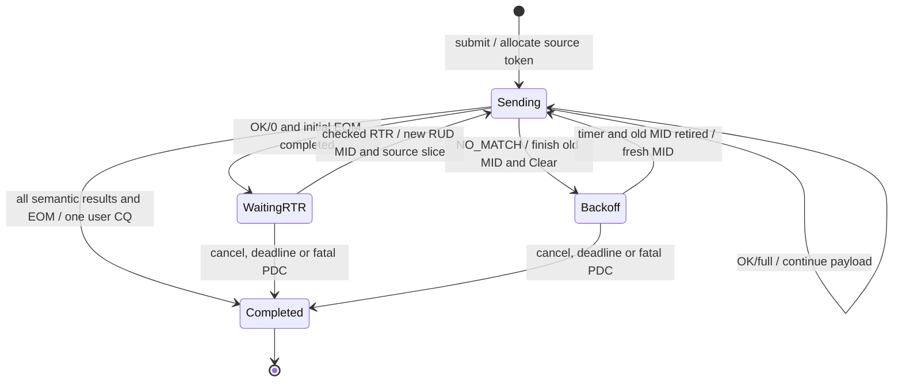

# Deferrable SEND：用户事务与多条线消息

原生 `OperationType::DeferrableSend`（0x08）和 `DeferrableTaggedSend`（0x0b）
在原 SES → PDS → CMS → fabric 路径上执行。依据 §3.4.3.1、§3.4.4.6 和
§3.4.5.4，发起端可以先发送一个包，随后根据语义响应继续、退避或等待 RTR。
默认目标仍采用 [DS-as-SEND](DEFERRABLE-AS-SEND.md)；调用
`target.enable_deferrable_capture(header_limit, local_rank)` 可启用有界的头部捕获。
省略 `local_rank` 时以节点 ID 代理 Job 内 rank，这是模拟器策略。
`deferrable_send` / `deferrable_tagged_send` 描述源 API；`deferrable_header_capture`
只在启用捕获后为 true，不能与默认目标的 as-SEND 兼容能力混用。

## 为什么需要三种身份

| 身份 | 代码中的所有者 | 生命周期 |
|---|---|---|
| 64 位用户 operation ID | `DeferredSource::operation` | 一次 submit 到一次最终 CQ，跨退避和重启保持不变 |
| 16 位 message ID（MID） | `Pending`、`SourceMessage`、`MessageLease` | 每次初始、重试、重启或内部 RTR 各自分配；EOM 和 Clear/连接退休前不能复用 |
| 32 位 restart token | `DeferredSource` / `DeferredTarget` 与 FEP 的 `Services` | 定位逻辑事务或保留投递；不是 MID、MR key 或执行器地址 |

`Services::next_semantic_restart_token` 使用 64 位游标管理 32 位线 token，初值1，
耗尽后明确失败，不回绕。源端从1分配是本地策略，目标仍接受对端合法的 source token0。替换同一 `PdsHost` 上的 Endpoint 不会重置游标。当前源事务
上限64；目标 header 上限由启用参数选择。两者都是有界模拟器资源策略。

## 源端如何停止与重启

首包保守地只发一个 payload MTU，暂不置 EOM。第一次正响应到达后，全长接受则继续
发送；延期则发送一个零 payload EOM，随后等待 RTR。`SourceMessage::started` 跟踪
包历史，避免把零字节 EOM 当作另一个 SOM。零长度消息通过 EXPECTED/OVERFLOW list
区分全长0接受和捕获头后的0长度延期。

NO_MATCH 表示没有捕获头，也不会有 RTR。源端先结束错误消息并等待旧 MID 退休，再
以新 MID 退避重试；策略为1、2、4、8、10 ms封顶。一条事务只有一个总 deadline，
重试不能无限续期。非零 target token 的重启不可再次延期；重复的同一保留 RTR 仅
确认，不产生第二次重启。源端支持零 target token 的再次延期。

RTR 验证顺序为 Job、网络 FEP、Job 内 rank、源 token、offset/length，全部合法后才
消费重启状态。`Operation::peer_initiator_id` 可指定期望的 RTR rank，默认代理为 peer
节点 ID。RTR offset 上限为 **2³²−2**，并须满足 `offset + length <= original_length`。
`SlicedPayload` 仅惰性读取所请求部分，不复制完整消息；重启保留原地址、tag、rank 与
header data，使用新的 RUD 消息。

## 目标端保留什么

启用捕获后，未匹配请求只保留头（J=0），不保存 eager payload。初始消息所有成功
响应持续为 OVERFLOW/RESPONSE、OK/0；即使投递在初始 EOM 前到达，也不改成全长接受。
捕获头与普通 ROD unexpected 消息使用同一到达序号选择投递。

投递匹配后，非零 target token 绑定确切的注册身份；收到初始 SOM 和 EOM 后，通过
原 PDS 发送 RTR，offset0、length 原全长。重启包逐次检查身份、范围和注册权限。
撤销并重用相同 key 不会将旧保留状态转向新 MR。目标应用 CQ 只属于保留投递，内部
RTR 不生成用户发送 CQ；内部控制仍拥有自己的 MID、PSN、语义响应和 Clear。

初始消息的 Incoming 可以在 EOM/Clear 后退休，捕获头仍然等待应用投递。目标端
使用有界表保存这种语义状态，不能把“PDS 已清理一个消息”误当作“整个事务结束”。
正常 PDC Close 后可以继续重启；不可恢复的相关 PDC 错误会终止未完成事务。
错误完成后的 MSG_ERROR/EOM 保留 token，且不再读取应用 payload。

源端本地取消/超时不能证明远端捕获头已释放。远端未匹配的头保持有界等待；随后投递
触发的 RTR 会得到无效 token 错误并释放该投递，或由目标 Endpoint 关闭/相关 PDC
失败清理。这里没有发明额外的取消 opcode，也没有假设双方可直接访问对方状态。

## 验证范围与证据边界

- `deferrable_transaction_test`：160个组合，SEND/tagged、RUD/ROD、NSCC开关、
  预投递/迟投递、兼容/捕获目标，长度0、1、1024、1025、4097；一次用户 CQ、目标
  字节、header data/tag，以及 MID、Incoming、token、timer 释放。
- `deferrable_restart_test`：独立 SES 脚本对端仍使用生产 PDS；验证 J>0 后缀、早到
  RTR、零 token 再次延期、新 MID 重复 RTR、晚到 RTR，以及错误 Job/FEP/rank/token/
  offset/length 不消耗有效事务。
- `deferrable_fault_test`：9类精确报文故障，分别覆盖首个延期响应、初始 EOM、RTR、
  重启 SOM、重启后数据/响应和延期 EOM 响应的丢失、重复或延迟；组合 SEND/tagged、
  初始 RUD/ROD、NSCC 开关。还检查取消、deadline、MR 撤销与 key 重用、截断、关闭、
  header 耗尽、与普通 unexpected 混合的双向 FIFO、显式目标 rank、重启读取失败、
  正常和失败的 PDC 生命周期。
- `deferrable_boundary_test`：独立44字节 RTR 黄金向量，IPv4/6、UDP/native IP、
  CRC开关；合法的对端 source token0、最后一个 token、Endpoint 替换、64个并发事务上限和恢复。4GiB−1逻辑源
  的最大合法 RTR 起点测试只读取17字节，**不算完整4GiB−1数据传输证据**。

早期 MR 撤销测试发现源错误完成后未驱动 abort tail；随后 failed-PDC 用例发现目标
Incoming 已释放但保留 token 残留。两项均保留失败日志并用同场景复验，不能靠 close
隐藏泄漏。最初配置命令用了未定义的 CMake 变量，已按项目实际变量重配 provider 与
reference；首轮 native-only 结果不冒充完整 provider 构建。

RTR token 半部按固定参考实现的 local/remote 角色解释：当前发送方在高32位、接收方
在低32位，因此 RTR 与原数据方向相反。黄金字节固定此布局；这不等于官方 RTR 实际
互通证明。固定参考的真实 RTR 双向互通、TSS、完整 Sync Group/跨退避顺序和 Profile
条款验收仍需独立推进。四种 Profile 标志均保持 false；本功能不代表整个 M5 完成。
