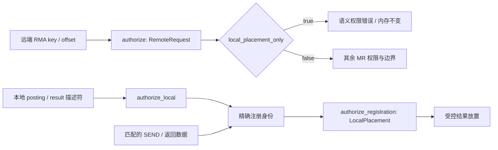

# 本地放置授权与远端 RMA 权限

接收posting、READ结果和取回原子结果，都需要本地可写的注册缓冲区。这份放置
授权来自应用提交的posting/operation。它不应给任意携带同一个数字key的远端
WRITE/READ/ATOMIC请求授予访问权限。

## 两条授权入口

`RegionOptions.local_placement_only` 是模拟器与provider的内部注册策略，不进入
UE线格式，也不改变RKEY编码。默认注册仍可用于按其权限授权的RMA；标记此项
的注册只服务于本地选择的放置。JobID、PID、resource index、权限、范围和撤销
身份继续逐项检查。

`MemoryRegistry::authorize` 默认处理 RemoteRequest。`authorize_local` 只从受信任的
本地提交入口调用；网络报文不能选择该入口。`authorize_registration` 验证此前
选定的活注册身份，再按 LocalPlacement 检查。它不能凭已撤销或另一个registry的
旧handle找到同名新注册。

因此，远端已知一个内部key也不能直接RMA写入该区域；应用投递的SEND、两条
READ返回路径和原子结果，可以依各自的posting/operation正常放置。Private在这里
描述寻址授权边界，并不禁止应用已经请求的网络数据交付。

## Provider 隐式注册

当前provider没有FI_MR_LOCAL要求，会为 `fi_recv`、非零 `fi_read` 结果、取回/CAS
结果建立临时注册。它们均设置local_placement_only，并在完成/错误或关闭posting
时撤销。公开 `fi_mr_reg/regv/regattr` 的远端权限继续由FI_REMOTE_READ/WRITE等
flags控制；内部可写注册不会额外扩大这些权限。

## 实际回归

`local_placement_scope_test` 验证相同key与R/W/Atomic位下的本地放置和远端拒绝，
包括相对/绝对寻址、RUD/ROD、NSCC、撤销及key复用。它随后实际完成已投递的
SEND/UUD、数据ACK与反向Request READ、缓存原子结果，并检查排空。

`libfabric_local_registration_test` 只通过公开fi_*创建一个接收posting，再让
原生协议对端故意使用夹具已知的内部数字key发起WRITE。旧provider二进制中，该
请求错误地成功并把首字节改成99；对应原失败保存在
`/tmp/softue-local-scope-before-regression.log`。旧二进制SHA256为
`aa71ce8c806a94ec791d904453b8be454b18d0bb26dca6beb864c3b45060dba3`，
产品源码来自后来提交为 `3d9ed4b` 的工作树。

新实现返回RC_OPERATION_VIOLATION(0x18)，缓冲区保持不变。随后同一个posting
正常接收SEND并产生正确接收CQ。公开READ与取回/CAS回归还检查各自的隐式结果
注册仍能正常放置；失败前后证据分别记录，未用隐藏key作为权限检查的替代。
