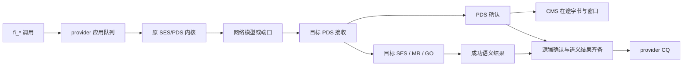

# Provider 完成等级与全局可见性

完成等级规定应用收到 CQ 后能依赖的最低保证。libfabric 2.0 `fi_cq(3)` 的
Completion Event Semantics 明确允许 provider 实现比所请求等级更强的完成语义。
它不是要求 provider 在满足条件的最早时刻立刻生成 CQ。

UE 1.1 §3.4.9.3 要求可靠消息等待全部 PDS 确认和语义结果，才能报告消息完成；
这足以实现 transmit complete。设置 SES DC 后，成功语义响应还保证目标数据
已经全局可见。当前 provider 对所有可靠操作都请求 DC，并选择这一更强的完成点。

| 请求 | API/CQ 的保证 | 当前策略 |
|---|---|---|
| inject API / `FI_INJECT` | API 返回后可复用源缓冲区 | 返回前复制至有界自有 payload，详见注入路径 |
| `FI_INJECT_COMPLETE` | 收到 CQ 后不再读取应用源缓冲区 | RDM 等待 GO；DGRAM 等待本地发送接受 |
| `FI_TRANSMIT_COMPLETE` | 可靠端点到达 peer；不可靠端点离开本地资源 | RDM 等待 GO；DGRAM 等待本地发送接受 |
| `FI_DELIVERY_COMPLETE` | 目标全局可见 | RDM 等待 GO；DGRAM 明确拒绝 |

GO 是 global observability（全局可见性）。模拟存储在目标 SES 成功写入并通过
权限/范围检查后才返回成功语义响应。当前没有异步主机总线/FEP 缓冲的独立延迟
模型，因此这些可靠完成等级共享同一个较晚的 CQ 时刻。能力查询保留应用请求的
等级；未指定时，RDM 默认 DELIVERY_COMPLETE，DGRAM 默认 TRANSMIT_COMPLETE。

较弱完成等级没有 `inject_size` 限制。没有 FI_INJECT 的普通大消息仍按需读取
应用缓冲区，应用等 CQ 后才能复用。`FI_INJECT_COMPLETE` 不等于立即归还缓冲区的
`FI_INJECT`，也不表示当前实现提前报告了完成。

`FI_FENCE` 还要求 fenced 操作的完成把前序操作提升到同样的完成等级。当前实现
对可靠操作统一请求 GO，加上应用 FIFO 等待最终语义结果，使跨 ROD/RUD 的前序
操作也满足这一要求；语义重试仍占住原先的队列位置。

下面是可靠操作的逻辑条件；PDS 确认和语义结果可以位于同一条 ACK 报文中。

`libfabric_mode_selection_test` 检查不同完成等级的实际 DC 位，并在 receive
尚未投递、SEND 仍需语义重试时确认没有提前 CQ。`libfabric_inject_test` 另验证
300 字节普通 SEND/WRITE 可使用较弱完成等级，覆盖默认等级与 DGRAM。持久化
`FI_COMMIT_COMPLETE` 尚未提供，能力查询仍明确拒绝。
