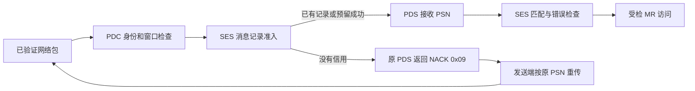

# 消息记录信用与 PDS 准入

SES 要记住一个消息的匹配结果、首错、已经接受的片段和完成状态。即使没有 payload
缓冲，这些记录也消耗资源。默认最多4096条；已有消息的后续分片必须继续使用原记录，
不能因为记录满了就丢掉首错，也不能对每个新包生成一条没有消息状态的保证错误。

标准请求现在在 PDS 接收之前预留消息记录。这个本地信用接口没有传输可靠性，
没有匹配 posting，也不访问 MR：

`Services::semantic_admission` 返回三个有明确含义的结果：

| 结果 | 含义 |
|---|---|
| `ExistingMessage` | 同一消息已经拥有记录，继续接收它的片段。 |
| `ReservedMessage` | 新预留了一条记录，之后才分配 RX handle 和交给 SES。 |
| `Rejected` | 暂时没有记录信用，由 PDS 返回 `UET_NO_SES_MSG_AVAIL`。 |

准入描述符只复制语义头和上下文身份，不复制 payload；其 RX handle 尚未有效。
`reserve_receive_message()` 立即插入记录，避免同一次 manager progress 中的多个
包在 SES 队列尚未处理时重复占用最后一个槽。`receive()` 执行真正语义处理时必须
找到该记录。应用缓冲匹配、Job/key/权限/边界和数据写入仍留在原 SES/MR 路径。

新建 PDC 还需遵守 §3.5.8.2：普通资源 NACK 不能创建上下文。manager 先选候选
本地 ID、预留记录，再创建 PDC；无信用时发 `SPDCID=0` 的 NACK。若 PDC 分配
失败，`cancel_semantic_reservation` 退回刚预留的记录。规定的 ROD 首包乱序可
分配 PDC 并返回 `ROD_OOO`，但不会提前预留尚未交给 SES 的消息。

已有 PDC 的拒绝发生在 `processRxReq()` 之前：不分配 RX handle、不推进接收
PSN、不设置 SACK，也不把拒绝的字节计入 CMS 接收计数。I_PDC 返回方向和 T_PDC
正向使用同一个准入规则。拒绝仍通过原 NACK 延迟、重试次数和 RUD/ROD 恢复机制
推进，不另建重传队列。

## Clear 如何解除压力

记录在规定的 EOM/Clear 或连接关闭后退休。接收端在准入前处理经过验证的
piggyback Clear；其本地事件可能在本轮 manager progress 之后才释放 SES 信用，
因此允许再 NACK 一次，随后正常重试。

没有后续数据请求时，源端也按 §3.5.11.4.3 主动发送 Clear Command。错误尾部
没有 REQ_CLEAR 位，不表示可以永久保留目标消息记录。定向测试同时检查空闲时
已释放记录，以及后续同PDC操作可以继续。

重传请求也必须带当前 Clear（§3.5.20.1）。`reTx()` 更新 `clear_psn_off`，保留
原 PSN 和语义内容。否则前一消息的尾包稍晚完成时，后续重传会永远带旧 Clear，
占住它自己所需的记录，形成死锁。`semantic_error_test` 的单槽场景检查重传线上
Clear 确实前进，并验证晚到错误分片不消耗新 posting、后续消息仍能完成。

`receive_admission_test` 检查两个方向的元数据准入、重复包不重复预留、初始
SYN拒绝不分配PDC、已建立PDC、原PSN重试、NSCC开关、资源恢复后的成功/坏key首错、
持续压力下的有限超时，以及分配失败回滚。现有 posting 保持到真正被接受的消息
匹配为止，内存不会在拒绝阶段改变。

消息记录信用与 ROD unexpected payload 耗尽时的 `DISABLED_GEN` 是不同资源。
本页覆盖当前标准 SES 请求；完整 tagged、READ、DS/RTR、TSS、RODL 的额外状态与
信用义务仍按各自路线实现。
