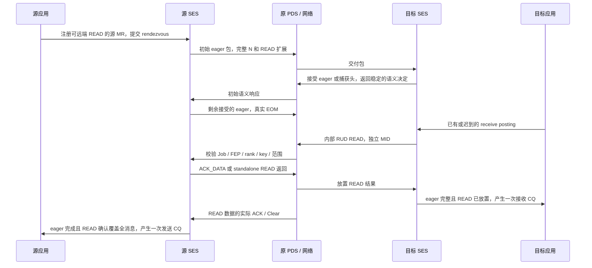

# Rendezvous：一条用户事务、两个完成点

原生 `Endpoint` 通过 `RendezvousSend` / `RendezvousTaggedSend` 提供标准 opcode
0x06 / 0x0a。它复用原 SES/PDS 和真实 READ，不依赖可靠网络后端。本文解释
§3.4.5.3 的事务状态；24 字节 Figure3-21 编码另见[线格式](RENDEZVOUS-HEADERS.md)。
这项能力不代表 HPC、AI Full 或 M5 已完成。provider 的大消息选择和私有源授权见
[公开 API 接入](PROVIDER-RENDEZVOUS.md)；完整 Sync Group、优化头、TSS 和完整
Profile 验收仍在计划内。

## 从应用缓冲区到完成事件



两端完成发生在不同的事实之后。源端不能在第一次生成 READ 响应时完成，也不能
只等 eager 的 EOM ACK；目标端不能用“已经发起 READ”代替结果实际放置。
零长度和 eager 覆盖全长也保留真实 READ，确保第二完成点存在。

## 三个长度分别说明什么

| 名称 | 含义 |
|---|---|
| `total_length` / 标准头 `request_length` | 完整用户消息 N，包含最终由 READ 获取的部分 |
| `eager_length` | 扩展头公布的 eager 上限 E，必须不大于 N |
| `accepted_eager_length` | 源端按第一次正响应决定的接受量，之后保持稳定 |
| `sent_eager_length` | 目标从实际 EOM offset 加 payload 得到的线上 eager 长度 T |
| `confirmed_bytes` / `placed_bytes` | 分别为已确认源字节、已放置目标字节的区间并集 |

E、接受量和 T 可以不同。乐观发起端可能在看到 OK/0 之前已构造多个包；被丢弃的
eager 字节仍需走完消息可靠性。目标保留实际 wire 覆盖与 SOM/EOM，等待空洞补齐后
才完成 eager，不能把 E 当作一定会发送的字节数，也不能在丢弃乱序字节时提前完成。

`ByteCoverage` 允许合法 READ 与 eager、其他 READ 部分重叠，只计算区间并集。
普通 READ 分片继续用更严格的 `ReadCoverage` 拒绝重叠，二者职责不同。

## 原生接口与内存授权

`Operation.rendezvous_source` 是本地可信描述符：

```cpp
Operation operation;
operation.type = OperationType::RendezvousSend;
operation.peer = 2;
operation.rendezvous_source = RendezvousBuffer{
    source_registration.key, source_offset, message_length,
    source_wire_pid, source_resource_index, source_generation};
operation.rendezvous_eager_length = eager_limit;
operation.context = application_context;
const uint64_t operation_id = endpoint.submit(operation);
```

注册必须授予 READ，且不能是仅供本地放置的 MR。provider 可以创建专供本地事务
读取的 `rendezvous_source_only` 注册；它不授予任意远端请求通用 READ 权限。
提交时检查源资源映射、Job、权限
和完整范围；每次读源数据重新验证同一注册身份。源 key 撤销后再用同一数值注册新
缓冲区，不能让旧事务复活。任意 `payload_source` 不能替代这里的真实注册源。

每次尝试分配一个只读临时 MR 视图，扩展头公布该视图的 key 与 offset0。视图只占
元数据，映射原消息，不复制整条消息。`registered_source` 固定原注册，
`rendezvous_source_aliases_` 将临时 key 关联到本地逻辑事务。合法反向 READ 必须先
匹配 Job、对端 FEP、Job 内 rank 和资源地址；错误身份不能消耗合法事务。临时视图
没有 WRITE 权限，完成、取消或超时后撤销。

相对源 PID、绝对源 PID 和本地 MR PID 不能混用。目标按扩展头的 PID、RI、generation、
key 和 offset 原值构造 READ；本地 READ 结果则固定到 posting 已选择的精确注册。
所有线上地址均为受检数值，不解释为主机指针。

绝对地址的 AnyJob posting 可以接受本地未安装的发送者 Job。内部反向 READ 仅继承
该已验证 posting 的授权，不调用 `add_job()`，普通公共 READ 提交仍要求本地 Job。

## 消息与事务的所有权

| 状态 | 负责的对象与释放条件 |
|---|---|
| 用户 operation ID / context | 源逻辑事务保存，跨重试不变，只产生一次用户 CQ |
| eager MID / PSN / EOM | 原 PDS 拥有；应用先失败也需尾部与 Clear 或连接退休 |
| 每次 READ 的 MID | 目标内部提交，应用 ID0；不产生额外用户发送 CQ |
| READ response credit | 一个真实 PDS 接收包，确认/失败回调固定事务 ID 与 attempt |
| 捕获的目标头 | 有界目标事务，可以比初始 eager Incoming 活得更久 |
| receive posting | 只选择一次；READ 放置沿用原注册身份，不按旧 key 重选 |

源端初始只发一个无 EOM 的包，等待接受决定；之后缩短 eager 或补发零 EOM。
NO_MATCH 和可恢复 generation/disabled 错误使用新 MID 和有界指数退避，单一总
deadline 不因重试重置。每次尝试更换 alias key，旧 READ 回调的 attempt 不得计入新轮。

ACK_DATA 的确认来自实际 ReceiveCleared；正常连接 Close 可提供隐含确认，错误
Close 不算成功。standalone READ 返回须收到真实反向语义 ACK。源端还保存每条 READ
的确认覆盖和末包，避免零 READ、部分 READ 或迟到确认造成提前用户完成。

## 目标策略、资源和接收顺序

当前模拟器策略：

- 有 posting 时接受 E；无 posting 时捕获头并稳定返回 OVERFLOW/OK/0。迟到 posting
  不改变第一次语义结果。
- 目标总是 READ 完整 N。§3.4.5.3 允许多读，这个策略能覆盖 eager 被缩短的情况；
  eager 与 READ 的重叠由 `placed_bytes` 合并。
- 默认每端最多64条源事务、64个目标头。ROD 头耗尽使用 disabled/generation 恢复；
  RUD 可返回 NO_MATCH。头资源恢复独立于下一次应用投递。
- ordinary unexpected payload、deferrable 头、rendezvous 头按语义到达顺序选择同一
  匹配 posting。共享 FIFO 测试用独立 PDC 让三类到达都可见；同一 ROD PDC 上，前一条
  delivery-complete SEND 的未放置 EOM 可以合法阻塞后续首次语义响应。

这些是实现策略与资源上限，不是对所有硬件实现的要求，也不等于完整 Sync Group。

## 错误、取消与两端可见性

第一处错误保持到消息尾部与 Clear；源 reader 失败停止读取，剩余尾部通过标准
MSG_ERROR 排空。目标 posting 截断不越界写入，撤销/复用目标 key 不会改写新注册。
本地取消和总超时撤销 alias 并发布一次源 CQ，不能发明私有远端取消 opcode。

截断等 posting 错误也保留 SOM 中的 CQ header data，包括值0。如果 RUD 的
continuation 先到，错误 CQ 等待 SOM；只保存完成元数据，并由既有 Incoming
资源预算限制数量。SOM 缺失时管理关闭回收该状态，保留最初的错误而不虚构数据。

源端已取消时，目标捕获头可能仍有界等待 posting；迟投递 READ 会得到 key 错误，
或者由管理关闭回收。源 PDC 本地重试耗尽也不保证对端同时获知；对端未完成事务
保留到其自身 PDC 失败或管理关闭。生命周期测试分别强制两侧真实 PDC 失败，检查
用户 CQ、内部 READ、MID、Incoming 和计时事件的所有权。

§3.4.5.2 允许 READ 请求端在本地结果放置失败时仍返回 DEFAULT。所以源端成功并不
能证明目标应用未取消或其 MR 未失效。目标取消内部 READ 后仍可排空迟到数据。
直接关闭 Endpoint 会拆除 SES handler：ACK_DATA 可由 PDS 继续处理，而 standalone
返回仍需要 SES 语义响应，源端可能等总超时。两种结果必须分别检查，不能伪造远端错误。

## 可运行的证据

```sh
cmake --build build/cmake -j2
ctest --test-dir build/cmake -R '^rendezvous_' --output-on-failure -j1
```

| 测试 | 观察的事实 |
|---|---|
| `rendezvous_header_test` | 独立24字节黄金向量、每个分片、两种IP/封装/CRC与拒绝截断 |
| `rendezvous_source_test` | 独立 SES 策略经过真实 PDS，448个源场景，两种完成先后和合法重叠 READ |
| `rendezvous_transaction_test` | 原生双端448个场景：预投递/迟投递、SEND/tagged、RUD/ROD、NSCC、零/MTU/多包 |
| `rendezvous_target_eager_test` | advertised64、accepted0、实际 EOM32，延迟被丢弃的16字节空洞 |
| `rendezvous_fault_test` | 丢数据/响应/确认、重复乱序、取消/超时、MR复用、截断和头耗尽恢复 |
| `rendezvous_isolation_test` | 双向同MID、Job/FEP/rank隔离、只读 alias、AnyJob不授予新本地Job |
| `rendezvous_boundary_test` | 非法本地组合、权限/范围、区间并集、64源上限、最大逻辑长度及末字节真实 READ |
| `rendezvous_lifecycle_test` | 三类共享FIFO的全部顺序、正常/失败PDC、目标关闭和一次完成 |
| `rendezvous_malformed_test` | 初始/后续头不一致、错误扩展字段、MSG_ERROR和不可能的语义完成长度 |
| `rendezvous_addressing_test` | 不同相对/绝对源与目标PID、两个generation、BAD_GENERATION重试和自定义反向rank |
| `rendezvous_source_scope_test` | 私有源授权、直接RMA拒绝、精确注册与实际事务 |
| `rendezvous_truncation_test` | 首个SOM/延迟SOM的截断CQ数据，以及SOM缺失后的关闭回收 |

最大逻辑长度测试只传输 eager 和末字节，**不是完整4 GiB rendezvous传输证据**。
READ 自身的完整4 GiB−1实验见 [READ-BOUNDARY.md](READ-BOUNDARY.md)，不得移用于此能力。
固定参考实现用 deferrable 策略代替真正 rendezvous；它不是此功能的 UE1.1 语义 oracle。
