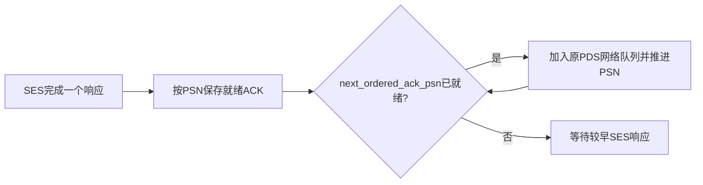

# 异步 SES 与 ROD 的 ACK 顺序

UE 1.1 §3.5.21.1要求ROD的ACK遵循被确认请求的顺序。SES仍可异步完成：
一个delivery-complete SEND在unexpected storage中等待应用贴入接收缓冲时，
后续WRITE已经可以完成授权和内存写入。后者的ACK必须等待前面的SEND响应就绪。

修复前的独立探针先发送SEND、再发送WRITE，捕获到请求PSN依次为`N, N+1`，
ACK却依次为`N+1, N`。这个错误不会由“请求固定走一条路径”自动消除，原因是
ACK在目标SES完成时生成，完成顺序可以与接收顺序不同。

每个PDC有独立的`next_ordered_ack_psn_`和`pending_ordered_acknowledgments_`。
起点是该接收方向的Start_PSN，NOOP/NO_NEG等普通编号控制确认也经过同一路径。
就绪map以完整32位PSN为键；释放过程按下一个PSN逐项查找，所以回绕时不依赖map的
数值排序。接收窗口限制可持有的响应数。关闭、失败和上下文重用清空map与前沿。

顺序门限约束每个PSN的首次ACK。§3.5.21.1也要求在后续请求继续发送时处理旧重复包，
并允许重发以前的保证响应，因此已经发出的旧ACK仍可响应重复包/ACK Request而重放。
尚未首次发出的缓存响应继续等待顺序门限，不能借查询绕过前面的未完成事务。
RUD保持独立响应策略。

队列保留原触发包的entropy、CE、RETX和到达时间。具备NIC时序的ACK_CC在真正发送时
仍重新stamp service_time，包含顺序等待造成的目标延迟。保证响应缓存继续由Clear释放；
顺序前沿和Clear不是同一个状态。

`ordered_acknowledgment_test`验证：

- 逆序就绪的三个响应按PSN首次发出，含UINT32回绕。
- 缓存查询无法越过门限，已发旧响应仍可重放；RUD可独立完成。
- 失败关闭后清空等待记录，再次使用相同对象不会继承前沿。
- native SEND加两个分片WRITE的16种NSCC、IPv4/IPv6、原生/UDP、控制预建连组合。
  WRITE先改变目标内存，源端完成等待SEND贴入；各消息分片不交织，最终完成与Clear回收。

unexpected-buffer耗尽回归相应检查：较晚消息的错误ACK等待较早SEND完成，应用先收到
早期成功，再收到后续错误。错误码、generation和独立RMA授权继续核对。
READ返回数据和RODL尚未启用，仍需按各自的顺序与封装规则验收。
