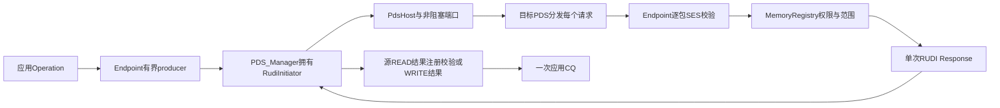

# RUDI线格式与事务边界

RUDI是针对幂等操作的可靠无序交付，见§3.5.23。目标允许重复执行同一请求，可靠性
由源端逐包重试提供；适用于RMA WRITE/READ。它不使用PDC和UET拥塞控制，目标不保留
PDS/SES恢复状态，也不产生目标消息完成。READ数据在同方向的RUDI Response中返回。

| 属性 | RUD/ROD | RUDI | UUD |
|---|---|---|---|
| 传输关联 | PDC与PSN | 源本地32位pkt_id | 无可靠交付关联 |
| 目标重复处理 | PDS去重 | 幂等操作可重复执行 | 不保证去重 |
| 响应 | ACK/NACK及语义响应 | 每个请求一个Response；源负责重试 | 无远端确认 |
| Clear | 回收保证响应等状态 | 无目标恢复状态需要Clear | 无Clear |

## 8字节头

已复核规范PDF第343页（index342）的Figure3-74，渲染图为
`/tmp/ue-rudi-header.png`。它的第一行包含prologue16位及reserved16位，第二行才是
pkt_id32位。Table3-48没有单列该reserved word；按表中有效字段相加得到6字节会错位。

| 顺序 | 字段 | 线宽 |
|---|---|---|
| 0 | type5 / next_hdr4 / flags7 | 2字节 |
| 1 | reserved | 2字节，发送为0，接收在完整性检查后忽略 |
| 2 | pkt_id | 4字节，网络字节序 |

type4为Request，type5为Response。flags.retx位表示重传；flags.m只在Response中有意义，
用于回显请求的ECN标记，Request中该位保留。pkt_id是源本地响应关联号，不是PSN，
也不编码PDCID。每个标准请求/响应的SES头紧接在完整8字节PDS头后。

`PDS_RUDI_header` 只保存本地字段。UetWireCodec显式编解码prologue、reserved word和
pkt_id，不序列化C++结构体。原有NACK的nt/pkt_id字段在线格式上另有定义；其运行时
分发及可靠性仍属于事务接入工作。

## 线格式证据

`rudi_header_test`有288组独立字节向量，覆盖WRITE/READ Request、语义Response、带数据
Response、IPv4/6、UDP/native、CRC、retx、ECN回显、ID0/0xabcd1234/UINT32_MAX、保留
字段及逐字节截断。Header的独立向量包含reserved word，避免只验证往返编解码。

固定参考5b4e049的parser/CRC与既有格式一起比较48个报文，包括RUDI请求和响应，
使用默认/自定义UDP端口。参考源码及shared library保持不变，测试wrapper额外输出
其解析的pds_rudi_pkt_id。基于009ca6b的工作树改动通过两项普通检查及两项
ASan/UBSan/泄漏检查；日志为 `/tmp/softue-rudi-header-tests.log` 和
`/tmp/softue-rudi-header-asan-tests.log`。运行期间另有完整版本编译，因此只作为
功能证据，elapsed不作为网络性能或基准指标。

## 原生事务架构

原生 `Operation.delivery_mode=RUDI` 选择无立即数的WRITE或READ。远端注册必须明确设置
`RegionOptions.idempotent_safe`；READ结果仍用可信本地 `ReadResultBuffer`。SEND、tagged、
NO_OP、立即数和atomic不走此路径。能力项 `rudi_write/rudi_read` 只描述原生接口的这个
范围；四种Profile完成标志仍为false，公开libfabric没有新增自动RUDI选择策略。

四种身份有不同的寿命：应用operation ID是64位；SES MID是16位；RUDI pkt_id是32位；
NIC attempt是本地64位。pkt_id不是PSN，不能拿去推进PDC窗口。源FEP的64位分配游标
`Services.next_rudi_packet_id` 跨Endpoint替换保留，允许线值0及UINT32_MAX，耗尽后显式
失败而不回绕。这个保守分配策略避免旧响应与新MID相同的操作发生关联。

`RudiInitiator` 是现有PDS_Manager的子状态机，不是独立可靠网络栈。它只在源保留有界
逐包副本，重传原pkt_id并设置retx。目标不分配PDC，不保留Incoming、去重表、响应cache
或整个消息的组装状态，也不发送Clear。同一WRITE可以再次放置相同字节，同一READ可
重新读取当前值；这不承诺“恰好执行一次”，READ丢包恢复也不是快照读。

## 时钟、背压与回收

每个请求的RTO从NIC首位实际离开时开始；没有发送时间回调的端口以本地接受边界代替，
不宣称拥有链路时序。WouldBlock期间不开始RTO。计时器只标记工作并wake，真正重发仍
由PDS progress处理。超时退避与有限0..14/无限15的重试设置复用现有策略；重复NACK
不重复扣预算，资源NACK使用配置延迟。收到裁剪请求时目标发nt=1的NACK；收到裁剪
Response时源重发原请求，不对Response发送NACK。

源默认最多4096个逐包状态，已终结但等待SES接收的结果也占这个预算；Endpoint默认
producer窗口8，收到逐包响应后才释放对应producer槽。每次READ结果还重新验证最初
选中的本地registration身份，数值相同的新key不能接收旧数据。关闭/取消先停producer、
取消packet timer、使背压中的旧attempt失效，再给应用完成；已离开端口的请求仍可能
作用于远端，协议没有虚构的RUDI取消包或MSG_ERROR尾包。

## 目标授权与网络类别

目标对每包独立解析Job、相对/绝对PID、RI及generation，并检查MR key、幂等许可、
访问方向与完整请求范围。然后才计算该包的放置地址。READ响应携带原MID和 `message_offset`；源还核对FEP、pkt_id、Job、MID、offset与片长。接收到的地址从不作为主机指针。
私有 `local_placement_only` 和 `rendezvous_source_only` 注册保持原来的权限边界。
需要ACK/Clear确认的rendezvous别名暂不接受RUDI READ，防止绕过事务绑定和完成条件。

§3.5.23不使用UET拥塞控制。即使FEP启用NSCC，也不为RUDI创建CCC或扣拥塞信用。
Table3-86要求WRITE Response使用DSCP_CONTROL，READ数据Response使用可裁剪类别；
请求也使用可裁剪类别。仿真端口的本地策略把RUDI数据分到TC2，控制响应到TC1；具体
DSCP数值沿用运营配置，不把本地TC编号当成规范常量。

## 当前回归与验收范围

初次原生回归包括：源状态机8场景、事务96场景、独立PDS攻击/源拒绝28场景以及生命
周期7场景，四项普通回归和ASan/UBSan/泄漏检查分别通过。之后按Table3-86追加分类
断言，并把WRITE控制响应从可裁剪故障矩阵移除；最终场景数与集成结果另行记录。

最初权限fixture把未配置相对PID2误期望为MR权限错误，实际正确结果是BadPid；已保留
原失败日志并分别覆盖BadPid及“PID已映射但MR不属于该PID”的权限错误。关闭fixture
原先把尚在线路串行化的Fabric事件也当成残留协议timer；现在用首位离开后丢包保持真实
RTO、同时排除无关的在途帧，严格核对关闭后timer为空。

追加Table3-86断言后，94个事务场景覆盖正常矩阵和适用故障；WRITE控制响应不进入
可裁剪故障矩阵。分类修复前负例为 `/tmp/softue-rudi-classification-before-tests.log`。
固定参考以原shared library接收1113字节多包WRITE；收到WRITE完成后，源再发1024与89
字节的两个独立READ核对相应区域。初次该独立范围的互通通过，日志
`/tmp/softue-rudi-reference-tests3.log`；最终完整集成证据另记。

尝试同一1113字节READ时，参考把续包payload_length按返回长度解释，当前原生无payload
策略则编码0，导致空尾片被正确拒绝并超时。该差异记录在 [READ.md](READ.md)，仍需
完整规范复核。参考源的RUDI事务未在此互测中覆盖；不扩大单方向及独立READ的证据范围。

完整回归及最终集成证据仍在补充。RUDI的TSS组合、完整管理/流量类别配置、
公开provider策略及HPC适用项的完整验收仍开放；不能据此声明HPC或整个M5完成。

停止全部其他编译后，顺序完成14/14普通集成检查（2.86s）与14/14 ASan/UBSan/泄漏检查
（9.01s）。日志为 `/tmp/softue-rudi-final-normal-tests.log` 与
`/tmp/softue-rudi-final-asan-tests.log`。其中四个原生状态/事务/权限/生命周期测试最终共
137场景，另有288个线头向量、既有Endpoint/PDS/同步/裁剪及两项独立参考检查。
这些是基于626248a的工作树功能证据，完整干净版本回归另记。

可用 `cmake --build build/cmake --target rudi_tests -j2` 构建五个原生回归，再运行
`ctest --test-dir build/cmake -R '^rudi_.*_test$' --output-on-failure`。
实时参考互测前应停止其他编译和CPU实验；墙钟耗时不是仿真网络性能。

## 干净版本完整回归

合入RUDI与READ重执行Clear修复的946e0ec，在干净工作树完成全量普通与消毒器构建。
停止全部其他编译后，顺序通过126/126普通回归（120.33s）及126/126 ASan/UBSan/
泄漏检查（541.84s），包含公开provider与独立参考进程。日志为
`/tmp/softue-rudi-clean-normal-tests.log`、`/tmp/softue-rudi-clean-asan-tests.log`。
同一提交的GitHub run43527771659（workflow164）普通、消毒器与参考作业全部成功。
这些结果属于946e0ec；后续优化头基础及事务接入分别验收，不重标旧二进制。
