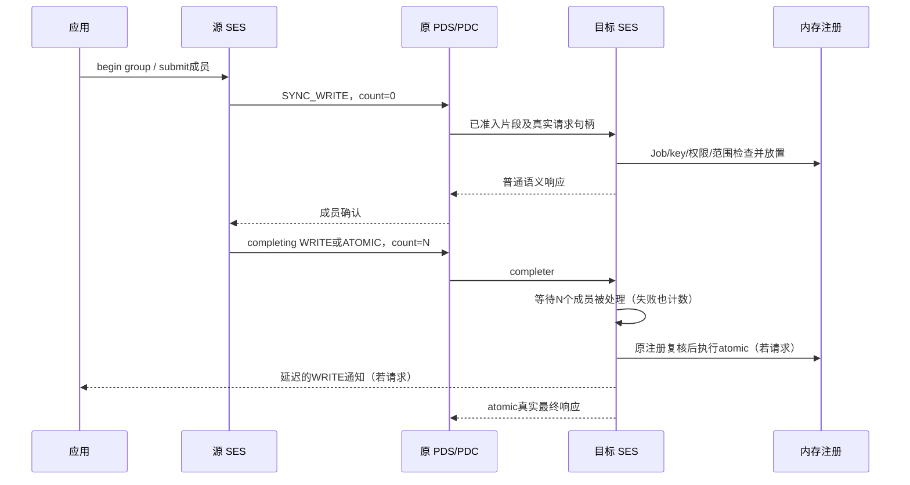

# 原生同步组事务

本节对应 UE1.1 §3.4.2.5.5、§3.4.2.7.4、§3.4.3.6、§3.4.4.8及
§3.4.9.6。标准线格式见 [SYNCHRONIZED-HEADERS.md](SYNCHRONIZED-HEADERS.md)。
这是有界的原生 SES 功能；四个 Profile 声明仍为 false，剩余边界列在文末。

## 三种身份和四层职责

| 名称 | 含义与寿命 |
|---|---|
| application operation ID | 每条操作的本地64位编号；重试期间不变，只产生一次源 CQ |
| MID | PDS上的16位消息号；generation恢复使用新MID，旧MID仍须可靠排空 |
| synchronization group | 16位线上组号，0合法；收到全部成员确认后才能重用 |
| local owner/member serial | 目标内部64位序号；旧组过期后，迟到片段不能加入同号的新组 |

应用获得的 `SynchronizedGroup` 是含 Endpoint authority 的只读本地句柄。
另一 Endpoint、旧 Endpoint、错误 peer/Job 或已经结束的组不能借用它发送操作。
FEP Services 保存单调的分配游标，替换 Endpoint 不会把线上号从0重新开始。

SES负责组计数、内存授权和完成动作；PDS继续负责PSN、SACK、重传、响应缓存及Clear；
CMS负责原有拥塞准入；网络负责实际报文交付。组状态层不提供第二套可靠传输。

```cpp
auto group = source.begin_synchronized_group(peer, job, 2);
write.type = OperationType::SynchronizedWrite;
write.synchronization = group;
source.submit(write);
completing.type = OperationType::SynchronizedAtomic;
completing.synchronization = group;
source.submit(completing);
```

非completing WRITE的 `sync_count` 为0。WRITE带header data（包括值0）时成为
completer；SYNC_ATOMIC天然是completer，不能带header data。一个组必须有且仅有一个
completer，总消息数为1..65535，其中最多65534条非completing WRITE。

## 写入、计数和动作分别发生

RUD同步WRITE的payload立即按普通受检RMA路径放置，不为组内排序而等待。
其源完成仍按普通消息确认处理。completing WRITE的payload也立即放置，但目标通知
保存在独立action记录中；即使该消息的Incoming已经Clear，通知也不会丢失。

`processed_messages` 统计已处理的消息，包括失败成员，不统计收到的包数，也不只统计
成功写入。成员的首个语义失败只计数一次；其余成员继续。错误completer不执行动作。
重复completer、错误count、Job不符及额外成员不增加原组的有效成员数。

SYNC_ATOMIC缓存至多8字节的整数操作数，保留最初授权的精确注册身份。屏障满足时
再次核对该身份，再调用已有整数原子路径。撤销后复用相同数值key仍会失败；收到的
buffer offset不会被转换为主机指针。支持现有8/16/32/64位有符号/无符号非取回整数
操作，包括合计不超过8字节的元素数组和零字节atomic WRITE。



原生源允许应用先提交completing ATOMIC，但在其余逻辑成员得到确认后才开始发送。
这是有限PDC窗口的调度策略：先发送等待屏障的atomic可能阻塞Clear，使后续大量WRITE
无法全部进入窗口。completing WRITE仍正常发送并放置payload。
独立PDS生产者另行把atomic放在线上最前面，并从其他PDC发送成员，验证目标真实屏障。

delivery-complete atomic的最终请求句柄在动作之前保留在PDS中。不能先发送
`NO_RESPONSE` 再试图补最终响应：§3.4.4.3要求最终收到包满足完成语义，且§3.5.13允许
NO_RESPONSE被提升为DEFAULT。分片atomic保留至多8个非空片段及SOM/EOM标记的句柄，
动作完成后分别返回真实响应。新映射的分片atomic先通过编号NOOP建立PDC。
缓存操作数时Incoming仍未完成；[Clear处理](CLEAR-PROCESSING.md)也不会越过尚未返回
任何SES响应的真实句柄。动作完成后的响应和合法Clear共同控制其退休。

## 资源、恢复和清理

源最多保留64个组、4096个逻辑成员。目标默认64个组，可显式配置；成员预算与
Incoming预算一致。组使用注入的整数纳秒时钟及单一deadline，不读取wall clock。
目标从首次准入开始老化，不完整组的completer不会迟到执行或产生成功通知。

组资源满返回PDS `NO_SES_SYNC_AVAIL=0x1B`；消息预算满仍返回0x1A。PDS准入只复制
固定扩展元数据，不复制尚未准入的payload，也不推进被拒绝PSN。

BadGeneration/DisabledGeneration在地址准入前撤销临时成员预留；源保留逻辑ID和组号，
以新MID、退避及原deadline重试。相同资源上，只让最旧的同步恢复成员探测，得到成功
确认后才恢复后继。未准入的generation失败不产生目标header-data CQ；旧MID仍排空至
EOM/Clear。已处理的普通错误成员仍按Table3-31计数。

成功组收到全部确认后可回收线上号。未知错误、本地取消或超时的组号保守隔离，不绕回
未确认的旧组。取消只改变本地操作；已经在网络中的完整请求仍可能在目标完成。
本地失败可能使目标缺少成员，此时目标按不完整组策略老化；generation恢复则在事务
内部保留逻辑ID重试，不计为一个新的逻辑成员。
已开始且尚未发完的消息使用原MSG_ERROR/EOM路径排空。PDC致命关闭停止该incarnation
上的同步源事务；Endpoint关闭取消本地timer并清理句柄、action和预算。

目标完成后仍保留成员至Clear。合法新组可能先于异步Clear事件到达，此时暂回0x1B，
清理完成后由原PDS重试准入；已覆盖丢失独立Clear、靠piggyback Clear恢复的情况。

## 验证边界

- `synchronized_transaction_test`：原生源/目标、RUD/ROD、NSCC、提交先后、失败成员、
  分片且合计<=8字节的原子操作数。
- `synchronized_target_test`：独立PDS源把atomic先送达，跨PDC成员、Job/count错误、
  重复completer和额外成员、原MR撤销/同key重用、组老化及旧owner隔离。
- `synchronized_fault_test`：请求/确认/Clear丢失、重复、乱序及generation恢复。
- `synchronized_lifecycle_test`：Clear丢失时的组号重用、目标组资源恢复、取消、关闭、
  未完成WRITE通知、原生Endpoint替换和16位ID耗尽。
- `synchronized_validation_test`：本地拒绝、全部8种整数类型、零字节WRITE及超过一个
  PDC窗口的WRITE在先提交atomic时仍能完成。

固定参考实现5b4e049的SES/PDS与shared library保持不变。两进程互测在原有操作之外
增加：Soft-UE向参考发送两条WRITE加64位SUM的三成员组；参考向Soft-UE发送单成员
completing WRITE；参考请求的CPU coherent atomic按§3.4.9.2返回
`RC_AMO_UNSUPPORTED_OP`，目标数据保持不变。参考公开CQ将其映射为FI_EIO，原生trace
同时核对具体SES码。最终应用握手等待反向Incoming经Clear退休。

参考的排队非completing WRITE会取最终组count，未满足1.1要求的零值；因此不将该路径
列为成功互通。其任意成员错误会抑制completing action，也不同于1.1 Table3-31 Case1。
CPU coherent支持及完整参考多成员源互通均未声明。

仍待完成：优化头、浮点/复数、完整semantic-control与安全路径、跨层管理验收，以及
“目标动作已结束但旧成员未Clear”期间对非法提前追加的完整区分。当前在该最后区间用
资源NACK等退休；不能把已覆盖的Collecting状态Case3/4/5推广为Table3-31全部情况已验收。
公开libfabric同步API及完整Profile验收也仍开放。

可用 `cmake --build build/cmake --target synchronization_tests -j2` 构建该功能的8个
回归，再以 `ctest --test-dir build/cmake -R '^(synchronized_|synchronization_)'`
运行。两进程参考测试需按 [IMPLEMENTATION.md](IMPLEMENTATION.md) 配置固定参考依赖。
运行实时互测前应停止其他编译及CPU实验，避免调度竞争混入证据。

基于c76cbe0的工作树改动在停止其他编译后，顺序通过10/10普通检查（2.77s）及10/10
ASan/UBSan/泄漏检查（8.57s）。五个新增事务测试共覆盖192个场景；另外包含状态层、
线头、准入、既有Endpoint及两进程参考检查。日志为
`/tmp/softue-sync-native-final-normal-tests.log` 和
`/tmp/softue-sync-native-final-asan-tests.log`。此处是针对性证据，完整构建回归另行记录。
